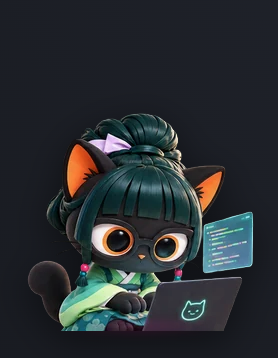

# Session Mascot

Mascota de escritorio que refleja en vivo lo que está haciendo **pi** (o **gentle-shell**): piensa, escribe código, ejecuta tests, busca, canta cuando genera texto y celebra cuando termina.

La interfaz es web (React + CSS + sprites) y corre en una ventana **transparente, always-on-top y click-through**; el cerebro es una extensión de pi que envía el estado por un named pipe local.



## Un plugin, dos hosts

| Host | Cómo |
| --- | --- |
| **pi** | Extensión `pi-session-mascot` instalada en `~/.pi/agent`. |
| **gentle-shell** | **La misma extensión**, en `~/.gentle-shell/agent` (gentle-shell aísla el home de pi). |

No hay dos plugins: gentle-shell arranca pi con otro `PI_CODING_AGENT_DIR`, así que se instala el mismo paquete en cada home. La app de escritorio es compartida.

## Arquitectura

```
pi / gentle-shell (TUI)
  └─ extension/session-mascot.ts       cerebelo: eventos → facts, config, IPC
        │  named pipe NDJSON (loopback)
        ▼
desktop/ (Electron)
  └─ renderer: React + CSS + sprites   cara: pinta y captura gestos
```

- El plugin decide estado, prioridad, comandos, layout y persistencia.
- El shell sólo pinta y obedece; no abre puertos ni habla con la red.
- El renderer se genera desde `desktop/ui/mascot-client.js` (la UI original), así que el arte y las animaciones son los mismos.

## Instalación (dev)

Requisitos: Node.js 20+, npm, pi 1.4+ (y gentle-shell si aplica). Probado en Windows 10/11.

```powershell
git clone https://github.com/deimerjr/session-mascot.git
cd session-mascot
npm install
npm start          # abre la mascota (Electron)
```

En otra terminal:

```powershell
pi --extension ./extension/extensions/session-mascot.ts
```

O instala la extensión de forma permanente en **pi y gentle-shell** (copia a ambos homes y crea la config con la ruta absoluta del shell):

```powershell
powershell -ExecutionPolicy Bypass -File extension\install.ps1
```

Reinicia pi/gentle-shell. Si el shell no está corriendo, la extensión lo lanza sola en sesiones interactivas (TUI/RPC); en `pi -p` no abre ventanas.

## Integración con gentle-shell

`gentle-shell` usa `~/.gentle-shell/agent` como home:

```powershell
powershell -ExecutionPolicy Bypass -File extension\install.ps1
```

- Config: `~/.gentle-shell/agent/session-mascot.json`.
- Los subagentes de gentle-shell corren como procesos pi hijos y **no** mueven la mascota: sólo la sesión principal.
- Si usas `gentle-shell --link`, pi usa `~/.pi/agent` y aplica la config vanilla.

## Comandos

```text
/mascota estado
/mascota on | off
/mascota reset
/mascota tamaño 55-190
/mascota auto on|off
/mascota debug
/mascota config
/mascota salir
```

## Configuración

En el home de pi en uso: `<home>/session-mascot.json`.

```json
{
  "enabled": true,
  "autoLaunch": true,
  "shellDir": "C:\\ruta\\a\\session-mascot\\desktop",
  "layout": { "x": 24, "y": 998, "scale": 1 },
  "debug": false
}
```

Variables: `PI_MASCOT_PIPE`, `PI_MASCOT_SHELL_DIR`, `PI_MASCOT_CONFIG`, `PI_MASCOT_LOG_PATH`, `PI_MASCOT_DEBUG=1`.

## Tests

```powershell
npm test            # renderer en Chromium (Playwright)
npm run test:e2e    # Electron real: ventana, fases, layout, reset, hide/show
```

## Limitaciones

- Ventana sobre el `workArea` del **monitor primario**; multimonitor pendiente.
- Aún no hay instalador empaquetado: el shell se ejecuta con `npm start` (Electron ~100 MB en `node_modules`).
- Probado en Windows. En macOS/Linux el pipe pasa a socket Unix, pero no está verificado.
- El arte está bajo “todos los derechos reservados” (ver [ASSETS.md](ASSETS.md)); el código es MIT.

## Licencia

Código MIT ([LICENSE](LICENSE)). Arte no incluido en la licencia MIT: ver [ASSETS.md](ASSETS.md).
